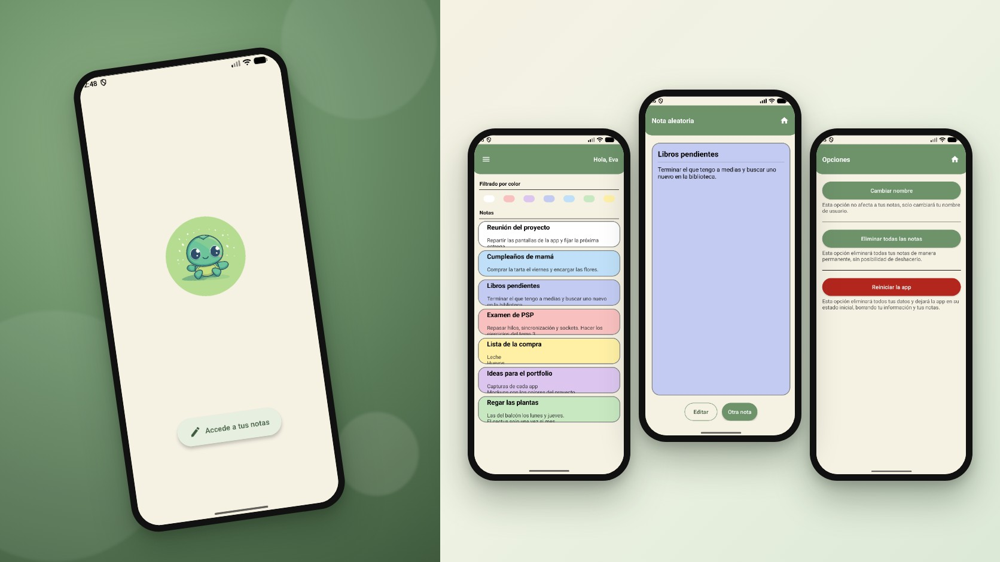
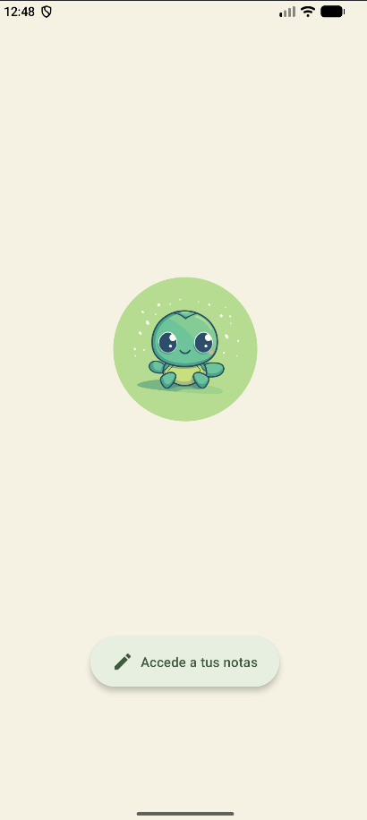
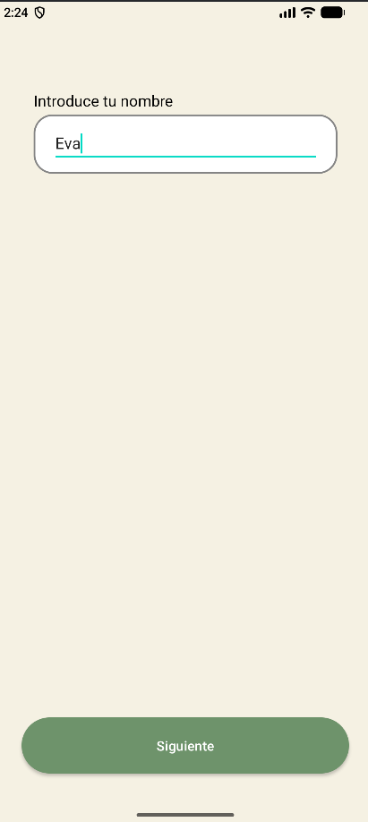
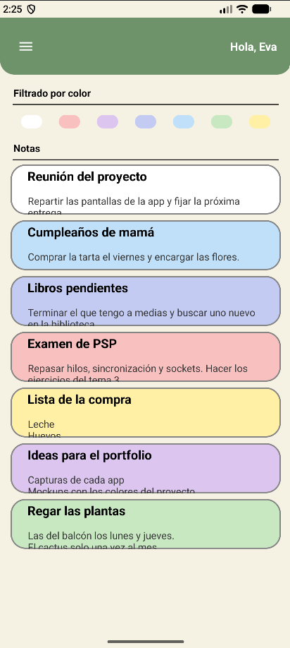
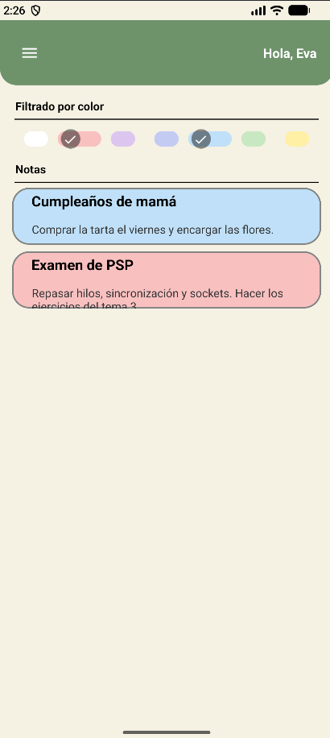
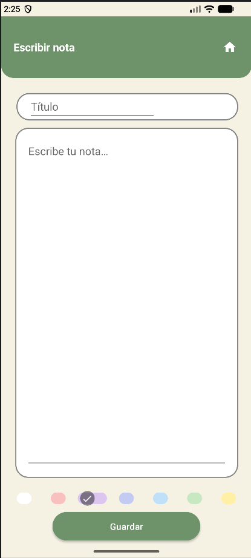
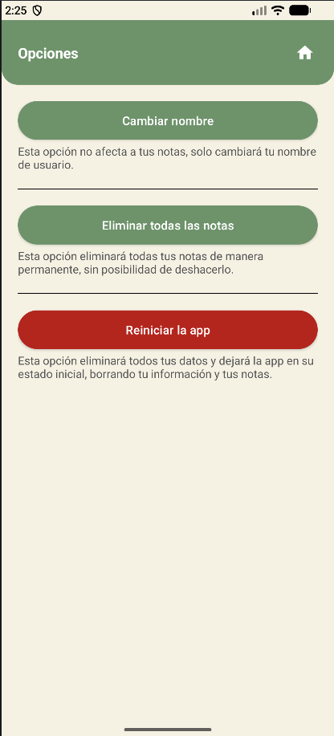
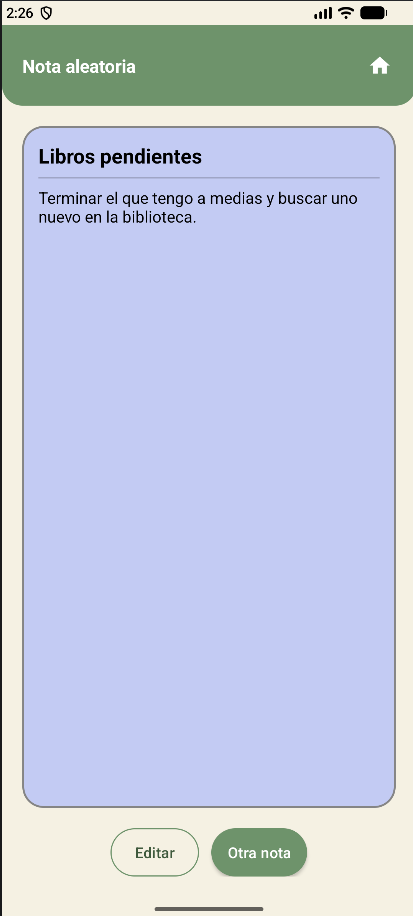
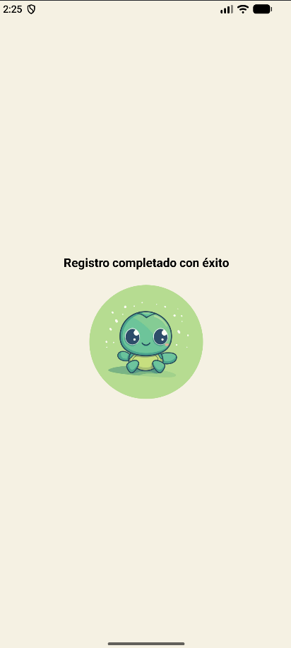

<div align="center">
  
</div>

<div align="center">
  <a href="https://github.com/evagr11/AppNotas/releases/latest" target="_blank"></a>
  <a href="https://github.com/evagr11/AppNotas" target="_blank"></a>
  <a href="https://evagr11.github.io/AppNotas/javadoc/" target="_blank"></a>
  <a href="https://www.figma.com/design/bGd0hNjlE58MXFdRMzW3rc/NOTAS" target="_blank"></a>
  <a href="docs/Documentacion_AppNotas.pdf" target="_blank"></a>
  <a href="https://evagr11.github.io/Curriculum/proyectos/app-notas.html" target="_blank"></a>
</div>

<div align="center">
  <a href="https://git.io/typing-svg"></a>
</div>

<div align="center">
  
</div>

# Sobre el Proyecto

**App Notas** es una aplicación Android nativa para tomar notas rápidas y organizarlas por colores. La primera vez que se abre, una bienvenida por pasos pide el nombre, una contraseña y el año de nacimiento; a partir de ahí la app saluda por tu nombre y te lleva directamente a tus notas, que puedes crear, editar y filtrar por color.

Todo se guarda en el **almacenamiento interno** del móvil, sin internet ni base de datos: cada nota es un pequeño fichero de texto.

**Características principales:**

*   **Bienvenida por pasos:** Tres `Fragments` (nombre, contraseña y fecha de nacimiento) que comparten los datos a través de un mismo objeto y validan que ningún campo quede vacío. Solo aparece la primera vez gracias a `SharedPreferences`.
*   **Crear y editar notas:** Título, descripción de varias líneas y un color a elegir. Al pulsar una nota de la lista se abre con sus datos para editarla.
*   **7 colores y filtro por Chips:** Cada nota tiene su color de fondo y la lista se puede filtrar marcando uno o varios colores a la vez.
*   **Persistencia en ficheros:** Cada nota se guarda como `notaN.not` y los datos del usuario como `datos.cas` dentro de la carpeta privada de la app (`getFilesDir()`), así que sobreviven al cerrar la aplicación.
*   **Datos del usuario ocultos:** El nombre, la contraseña y la fecha se guardan aplicando un desplazamiento de caracteres (cada letra pasa a la siguiente), para que no queden legibles a simple vista en el fichero.
*   **Menú lateral:** Un `NavigationView` con tu nombre y accesos a **Escribir nota**, **Opciones** y **Nota aleatoria**.
*   **Opciones:** Cambiar el nombre de usuario sin tocar las notas, eliminar todas las notas o reiniciar la app a su estado inicial. Las acciones que no se pueden deshacer piden confirmación.
*   **Nota aleatoria:** Muestra una de tus notas al azar con su color, con botones para ver otra o editarla.
*   **Una mascota:** La tortuga aparece en la bienvenida, en el menú lateral, en los avisos y como icono de la app.
*   **Diseño de Figma:** Cabecera verde, fondo crema y botones con forma de píldora de Material 3.

### Colores de las notas (tonos pastel)

<div align="center">

| Chip | Color |
| :--: | :---: |
| 1 |  |
| 2 |  |
| 3 |  |
| 4 |  |
| 5 |  |
| 6 |  |
| 7 |  |

</div>

### Galería

| Bienvenida | Registro | Lista de notas | Filtro por color |
| :--------: | :------: | :------------: | :--------------: |
|  |  |  |  |
| *La tortuga te da la bienvenida.* | *Registro por pasos.* | *Cada nota con su color.* | *Uno o varios colores a la vez.* |

| Escribir nota | Opciones | Nota aleatoria | Registro completado |
| :-----------: | :------: | :------------: | :-----------------: |
|  |  |  |  |
| *Título, texto y color.* | *Las acciones peligrosas piden confirmación.* | *Una nota al azar.* | *Y a tus notas.* |

# Contexto del Proyecto

Este proyecto se desarrolló en el ciclo formativo de **Desarrollo de Aplicaciones Multiplataforma (DAM)**, en las asignaturas de **Desarrollo de Interfaces** y **Programación Multimedia y Dispositivos Móviles**. El objetivo era practicar el desarrollo nativo en Android con Java: varias pantallas con `Activities` y `Fragments`, listas con adaptadores propios, componentes de Material Design y guardado de datos en ficheros.

# Stack Tecnológico

<div align="center">
  
  
  
  
  
  
  
</div>

<br>

<div align="center">

| Componente | Tecnología |
| :--------- | :--------- |
| **Plataforma** | `Android Nativo` (minSdk 24 · targetSdk 36) |
| **Lenguaje** | `Java 11` |
| **Interfaz** | `XML Layouts`, `Activities`, `Fragments`, `ListView` con `ArrayAdapter` propio, `Chips` de Material |
| **Persistencia** | Ficheros en el almacenamiento interno (`FileWriter` / `BufferedReader`) y `SharedPreferences` |
| **Build** | `Gradle` (Kotlin DSL) |
| **Diseño** | `Figma` |
| **Documentación** | `LaTeX` |

</div>

# Estructura del Proyecto

El código está separado en modelo, vista y una capa intermedia con la lógica, siguiendo una organización parecida a MVVM.

```bash
AppNotas/
├── app/
│   ├── build.gradle.kts
│   └── src/main/
│       ├── java/com/example/appnotas/
│       │   ├── Model/
│       │   │   ├── Nota.java              # Título, descripción, color e id
│       │   │   ├── ColorNota.java         # Colores disponibles
│       │   │   └── Usuario.java           # Nombre, contraseña y fecha de nacimiento
│       │   ├── ViewModel/
│       │   │   ├── LandingViewModel.java  # Guarda, lee y cambia el nombre del usuario
│       │   │   └── NotaManager.java       # Lee, crea, actualiza y borra los ficheros de las notas
│       │   └── View/
│       │       ├── Landing/               # Bienvenida: Activity y 4 Fragments
│       │       ├── GeneralActivity.java   # Lista de notas, filtro por color y menú lateral
│       │       ├── CrearNotasActivity.java# Crear y editar una nota
│       │       ├── OpcionesActivity.java  # Cambiar nombre, borrar notas y reiniciar
│       │       ├── NotaAleatoriaActivity.java # Una nota al azar
│       │       └── NotaAdapter.java       # Pinta cada nota con su color
│       └── res/
│           ├── layout/                    # Pantallas, cabeceras, diálogo y fila de la lista
│           ├── menu/                      # Opciones del menú lateral
│           ├── drawable/                  # Fondos de cada color e iconos del menú
│           ├── drawable-nodpi/            # La tortuga
│           ├── mipmap-*/                  # Icono de la app
│           ├── values/                    # Colores, textos, tema y estilos de botones
│           └── values-night/              # Tema para el modo noche
├── docs/
│   ├── Documentacion_AppNotas.pdf         # Documentación técnica en LaTeX
│   └── javadoc/                           # Javadoc generado (publicado en GitHub Pages)
├── .github/readme/                        # Mockup y capturas de este README
├── build.gradle.kts
└── gradlew
```

# Cómo Utilizar el Proyecto

### Instalar la APK

La forma más rápida de probar la app es instalar la APK de la última versión, en [Releases](https://github.com/evagr11/AppNotas/releases/latest):

1.  Descarga el archivo `.apk` desde el móvil.
2.  Ábrelo y, si Android lo pide, permite **instalar aplicaciones de orígenes desconocidos**.
3.  Pulsa **Instalar** y abre **AppNotas**.

> Necesita **Android 7.0 (API 24)** o superior. Funciona sin conexión: las notas se guardan en el propio móvil.

### Compilar desde el código

Para ejecutarlo necesitas **Android Studio** y el **JDK 11** o superior.

1.  **Clona el repositorio:**
    ```bash
    git clone https://github.com/evagr11/AppNotas.git
    ```
2.  **Abre el proyecto en Android Studio:** `File` > `Open` y selecciona la carpeta `AppNotas`.
3.  **Sincroniza Gradle** y espera a que se descarguen las dependencias.
4.  **Ejecuta la aplicación** en un emulador o en un móvil con el botón `Run 'app'`.

La primera vez verás la bienvenida; para volver a verla, usa **Opciones → Reiniciar la app**.

<br>

<div align="center">
  <p>Creado por <strong>Eva Gallardo</strong></p>
  <a href="https://github.com/evagr11" target="_blank">
    
  </a>
  <a href="https://www.linkedin.com/in/eva-gallardo-romero-830362349/" target="_blank">
    
  </a>
</div>

<div align="center">
  
</div>
